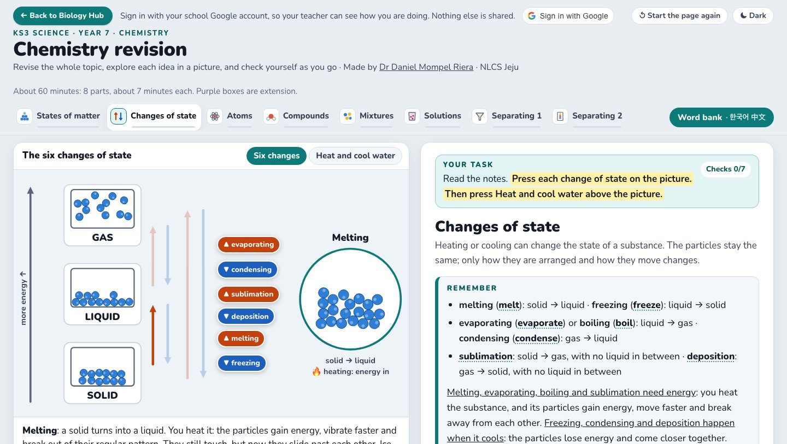

# Y7 Chemistry revision: states of matter, atoms and mixtures

**Live:** <https://nlcsbiology.com/ks3-y7-chemistry-revision/>

A revision page for Year 7 Chemistry: the revision booklet, made digital. Pupils read short notes for each idea, explore
it in a picture on the left, and check themselves as they go. It takes about 60 minutes (a double lesson): nine parts of
about 6 or 7 minutes. Pupils can use it instead of the paper booklet.

| Part | The picture to explore | The checks practise |
|---|---|---|
| 1 States of matter | one substance (not water) whose temperature decides its state: heat it until it melts, then boils; cool it back; compress it | particles and their movement, expansion and contraction (the particles do not grow), compressing a gas |
| 2 Changes of state | the six changes on an energy arrow, each shown in a lens; ice heated and cooled | melting, freezing, evaporating, condensing, sublimation, deposition; melting point = freezing point; physical and chemical change; the water cycle |
| 3 Atoms and elements | inside a helium and a carbon atom; the 13 elements to know on the periodic table | protons (+), neutrons (no charge), electrons (−); symbols; metals and non-metals; states at room temperature |
| 4 Molecules and compounds | boxes of particles; iron and sulfur, a mixture and then a compound | element, compound or mixture from a particle picture; formulae; diatomic elements; new properties of a compound; reading statements carefully |
| 5 Mixtures | a solution, a suspension and a colloid: a torch, a day left to stand, a microscope; a graph (salt on icy roads) | pure substance or mixture; alloys; the three kinds of mixture; reading a graph |
| 6 Solutions | a drink made stronger or weaker; a solubility curve; a chart to choose a nail-varnish remover | solute, solvent, solution, soluble, insoluble; concentrated and dilute; solubility and saturated solutions; independent, dependent and control variables; choosing from a chart |
| 7 Sieve, filter, decant, magnet | filtration of chalky water and of salt water; a sieve; layers of liquids | residue and filtrate; what a sieve cannot do; choosing a method; immiscible liquids; density and floating |
| 8 Evaporation, distillation, chromatography | simple distillation, evaporation, a chromatogram of food colourings, a cold tray over boiling salty water | the steps of distillation; keeping the solvent; the words of chromatography; reading a chromatogram; two written answers checked against a mark list |
| 9 Graphs and tables | the perfect graph and the perfect table, every rule numbered, hidden until the pupil presses Show it | finding the faults in a student's line graph and bar chart (tap each part that is wrong); naming the faults of a table; the title of a graph |

**Help, after the pupil has tried.** Key words are typed (spelling counts; capitals do not, except in chemical symbols). A
pupil who is stuck presses **Show the first letter**: the gap they are working on shows its first letter, and they type
the rest. Some checks have a **💡 Hint**: an idea to think about, never the answer. Every key word can be tapped for its
meaning, with Korean and Chinese, and the word bank has every word of the page. The answers can be shown only after two
tries.

**Graphs and tables.** Part 9 checks that pupils remember the rules of a perfect graph and a perfect table (the title and
what it says, the labels and their units, the tick marks, equal steps, crosses, bars of one width from 0). They tap each
part of a student's graph that is wrong; a fault is ringed in red with its reason, and a part that is right says so (it
counts on the board as a try). Then **Fix every fault** draws the same graph done perfectly.

**Scientific words.** Each new word is explained first and then named. Each part's notes end with **Say it like a
scientist**: the everyday words a pupil might write, and the scientific word that scores marks instead. Typed checks make
pupils write those words (compress, contract, reversible, transparent, saturated, immiscible, crystals, solvent front…).

**For the teacher.** A pupil who signs in with their school Google account has every check saved for their teacher, who
sees it live on the teacher page's 🔬 Practicals board: right first time, the number of checks, and what they struggled
with. A first letter or a hint counts as a try, so a question answered with help never shows as "right first time", and
the board names the help ("first letter, gap 2", "hint"). Signed out, the page works the same and nothing leaves the
computer. Answers survive a reload.

**Made for Year 7.** Big text, what to press written beside its button and highlighted, plain sentences for pupils who
learn in English as an additional language, and a bright and a dark version. Purple boxes are extension and do not count
in a part's bar. On a phone, each picture keeps a size that can be read, and the pupil swipes it sideways.

**Made by** Dr Daniel Mompel Riera, NLCS Jeju. Something wrong, or a suggestion? dmompelriera@nlcsjeju.kr

**Licence.** Code: AGPL-3.0 (`LICENSE`). Teaching material: CC BY-NC-SA 4.0 (`LICENSE-CONTENT`): free for teaching, not
for selling. Every picture on the page was drawn for it. The graphs use published data: freezing points of salt water
(CRC Handbook of Chemistry and Physics, rounded) and the solubility of potassium nitrate.

Behind the scenes

The `tools/` named here stay on Daniel's computer: they are not in this repository.

- `index.html` holds the notes of each part and a box for each check; `js/questions.js` every check (its id is its square
  on the teacher's board: keep the id when rewording); `js/words.js` which words the word bank shows.
- `js/checks.js` draws and marks the checks; `js/panel.js` the picture on the left, which changes when a pupil scrolls to a
  check that names a picture (`data-scene`); `js/scenes1.js` and `js/scenes2.js` the pictures; `js/draw.js` the drawing kit
  (particles, glassware, graphs) and the figures inside checks; `js/core.js` the tabs, the word bank and the progress bars.
- `js/signin.js`, `js/lesson.js` and `js/glossary.js` are copies of the Biology Hub's shared files (`labs-shared/`), made by
  `node tools/practicals-sync.mjs` in the workspace: never edit them here. A new word goes into the shared KS3 glossary first.
- After changing a check: `node tools/make-questions.mjs` (writes `data/questions.json`, which the teacher's board reads),
  then `node tools/stamp.mjs` (one version for `version.txt` and every `?v=`).
- `node tools/check.mjs` runs a pupil through the checks in headless Chrome (first letters, hints, the record the board
  reads, a reload); `node tools/shots.mjs <folder>` saves a screenshot of every picture after every press (`--dark`,
  `--part n`). `?still=1` makes every picture jump to its end state.
- Before a push, also: `node tools/sweep.mjs` (every check: a wrong answer is marked wrong, the right one right),
  `node tools/signin-check.mjs` (a stand-in labs script: only a listed pupil's work is sent, with the help named; a
  teacher and a pupil not on the list send nothing), `node tools/board-check.mjs` (the real teacher page draws this page's
  squares), `node tools/widths.mjs` (every picture after every press at six laptop window sizes, `--small-screens` for a
  tablet and a phone: no button over another, off the picture or over its words) and `node tools/phone-check.mjs` (a
  finger swipes the picture and drags a graph's ruler), `node tools/restart-check.mjs` (Start again, and the keyboard alone), `node tools/anyorder-check.mjs` (typed words that
  may come in any order, and the first letter that fixes its gap), `node tools/particles-check.mjs` (Part 1's substance
  melts and boils at the marked points; every particle box moves in calm slow motion) and `node tools/claims-check.mjs`
  (every picture does what it says: the size before heating stays still, counts match their keys, the graph ruler sits
  on the curve, beads stop in the right layer, each hint names a real button, scrolling brings up the right picture) and
  `node tools/faults-check.mjs` (Part 9: every fault has a part to tap, each press area sits on its own part and a press
  on a part selects it, a right part tapped counts once, Show the faults only after two, Fix every fault draws the
  perfect graph, the keyboard alone finds a fault, the hidden pictures open).

